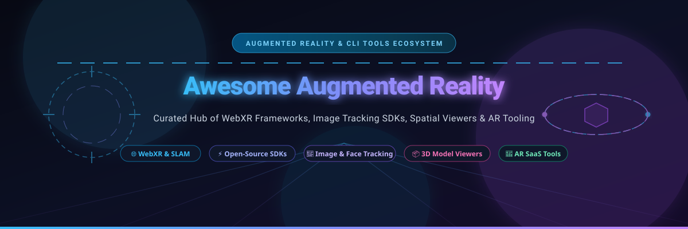

# 🚀 Awesome Augmented Reality &amp; CLI Tools 🕶️

**A curated, production-ready directory of top Augmented Reality (AR) frameworks, WebXR platforms, Marker/Image Tracking libraries, spatial 3D viewers, and command-line AR tools.**

*Discover enterprise SaaS engines, self-hosted WebAR SDKs, cross-platform mobile AR toolkits, and developer CLI utilities.*

[🌐 Overview](#-sector-overview--market-dynamics) • [💼 SaaS Platforms](#-saashosted-platforms) • [⚡ Open-Source Projects](#-open-source-github-projects) • [🤝 Support](#-support) • [⭐ Star History](#-star-history)

---

## 📌 Table of Contents

- [📊 Sector Overview & Market Dynamics](#-sector-overview--market-dynamics)
- [🏢 SaaS/Hosted Platforms](#-saashosted-platforms)
- [💻 Open-Source GitHub Projects](#-open-source-github-projects)
- [🛠️ Developer CLI & Pipeline Utilities](#-developer-cli--pipeline-utilities)
- [🤝 How to Contribute](#-how-to-contribute)
- [💖 Support](#-support)
- [⭐ Star History](#-star-history)
- [⚠️ Disclaimer](#-disclaimer)

---

## 📊 Sector Overview & Market Dynamics

The global augmented reality market is estimated at approximately **$120B–$140B in 2025** and projected to surpass **$160B–$210B in 2026**, registering an accelerating compound annual growth rate (CAGR) of **25%–35%**. 

The market exhibits a **bifurcated concentration profile**:
- **Platform & Operating System Tier (Moderately Concentrated)**: Foundational spatial computing operating systems, underlying neural tracking pipelines, and primary hardware platforms are dominated by major tech conglomerates (PTC, Meta, Apple, Google).
- **Application & Software Ecosystem (Highly Fragmented)**: The horizontal landscape across specialized authoring SaaS platforms, independent software vendors (ISVs), creative agencies, self-hosted WebAR engines, and open-source tracking toolkits remains dynamic and fragmented, with intense competition in browser-based WebXR and no-code creation suites.

---

## 🏢 SaaS/Hosted Platforms

| Platform | Company Valuation / Revenue | Pricing (Starting Tier) | Free Tier Limits | Description |
| :--- | :--- | :--- | :--- | :--- |
| **[PTC Vuforia](https://www.ptc.com/en/products/vuforia)** | ~$20.8B–$22.1B Market Cap / $2.74B Annual Revenue (PTC Inc.) | $99/month (Cloud Recognition Plus add-on); custom annual quote for Premium/Enterprise | **Free Forever (Basic Plan)**: Unlimited app development and commercial deployment without watermarks for core features (Image Targets, Multi-Targets, Cylinder Targets, VuMarks, Ground Plane); includes up to 1,000 cloud-stored images and 1,000 cloud recognitions/month. | Enterprise AR platform with industrial-grade 3D model, area, and image tracking. Vuforia Engine powers mission-critical enterprise AR across mobile, desktop, and headsets. |
| **[8th Wall](https://www.8thwall.com/)** | ~$3.5B Acquisition Valuation / >$1B Annual Revenue (Niantic / Niantic Spatial) | $0/month (100% Free Open-Source model; historically started at $300/month or $99/month Pro) | **Free Forever (Current Open-Source Model)**: Core engine, desktop tools, and self-hosted WebAR SDK released 100% free with no project caps, fees, or hosted subscription tiers. *(Historical Free Trial: 14-day trial with unpublishable test projects).* | Category-leading WebAR platform featuring markerless SLAM, 6DoF camera tracking, face effects, and spatial world tracking, now transitioning developers toward free self-hosted WebAR infrastructure. |
| **[ZapWorks](https://zap.works/)** | $45M Acquisition Valuation / ~$5.1M Annual ARR (Zappar / Infinite Reality) | $65/month (billed annually) or $99/month (billed monthly) for Pro tier | **14-day Free Trial** for paid Pro workspace; or **Free Developer Plan (Non-Commercial)**: unlimited projects and views strictly for non-commercial use, with Zappar branded interstitial splash screen, ~25MB project size limit, and 250 AI credits/month. | Full-stack AR creation ecosystem featuring visual web editors (Designer, Mattercraft, Studio) and Universal AR SDKs (Three.js, Unity, Babylon.js) with integrated cloud hosting. |
| **[Blippar](https://www.blippar.com/)** | ~$5M Post-Restructure Extension / ~$5M–$8M ARR (Candy Ventures) | £7.99/month (~$10/month) for Creative plan; £100/month for WebAR SDK | **Free Forever (Starter Plan)**: Unlimited project creation and internal testing in Design Canvas/Hub, but no live public publishing; or **14-day Free Trial** on paid publishing tiers. | Lightweight no-code AR authoring tool (Blippbuilder) and WebAR SDK featuring marker and image tracking positioned for fast marketing campaigns and interactive packaging. |

---

## 💻 Open-Source GitHub Projects

Curated list of leading open-source Augmented Reality SDKs, WebXR frameworks, computer vision engines, and 3D viewers. **Sorted in descending order by GitHub Stars ⭐**.

1. **[MediaPipe](https://github.com/google/mediapipe)**  
     
   Cross-platform, customizable machine learning solutions for live and streaming media by Google. Powers bleeding-edge face mesh, iris tracking, hand landmark detection, and pose estimation directly in browser and native AR pipelines.

2. **[A-Frame](https://github.com/aframevr/aframe)**  
     
   Web framework for building virtual reality (VR) and augmented reality (AR) experiences with declarative HTML and Three.js. Operates on an entity-component-system (ECS) architecture, bridging seamlessly into AR.js and MindAR for browser-native immersive scenes.

3. **[AR.js (Original)](https://github.com/jeromeetienne/AR.js)**  
     
   The foundational open-source library that introduced high-performance augmented reality to web browsers. Achieves 60 FPS on mobile phones through pure JavaScript and WebGL marker tracking.

4. **[model-viewer](https://github.com/google/model-viewer)**  
     
   Google's web component for easily displaying interactive 3D models and invoking augmented reality on the web. Makes launching WebXR, Scene Viewer on Android, and Quick Look on iOS as effortless as an standard `` tag.

5. **[AR.js (Organization Edition)](https://github.com/AR-js-org/AR.js)**  
     
   The community-maintained official organization fork of AR.js. Provides marker-based (Hiro markers), natural image tracking (NFT), and location-based AR (GPS coordinates) with dedicated A-Frame and Three.js builds.

6. **[ARCore Android SDK](https://github.com/google-ar/arcore-android-sdk)**  
     
   Google's official SDK for building Android augmented reality applications, enabling environmental understanding, motion tracking, light estimation, and Depth API integration.

7. **[MindAR](https://github.com/hiukim/mind-ar-js)**  
     
   Lightweight, high-performance web augmented reality library written in pure JavaScript. Built upon TensorFlow.js and Web Workers to deliver multi-image tracking and 468-point face tracking with Three.js and A-Frame support.

8. **[React XR (`@react-three/xr`)](https://github.com/pmndrs/react-xr)**  
     
   VR and AR framework for React Three Fiber by Poimandres. Enables declarative WebXR session management, hit testing, hand interactions, and spatial controller models in modern React applications.

9. **[ARCore Unity SDK](https://github.com/google-ar/arcore-unity-sdk)**  
     
   Google's SDK enabling developers to create cross-platform augmented reality experiences inside the Unity engine with surface detection and instant placement.

10. **[SceneView Android](https://github.com/SceneView/sceneview-android)**  
      
    3D and ARCore library for Android that succeeds Sceneform. Built with Google Filament for physically based rendering (PBR) of 3D models with environmental reflections.

11. **[WebXR Samples](https://github.com/immersive-web/webxr-samples)**  
      
    Official reference samples and demonstrations maintained by the W3C Immersive Web Working Group showcasing raw WebXR Device API capabilities including AR hit-test, anchors, and lighting estimation.

12. **[8th Wall Open-Source Tools](https://github.com/8thwall/8thwall)**  
      
    Open-source modular components, desktop apps, and command-line build tools from 8th Wall for packaging and compiling client-side WebAR experiences.

13. **[artoolkitX](https://github.com/artoolkitx/artoolkitx)**  
      
    Cross-platform open-source augmented reality software development kit based on the classic ARToolKit foundation, supporting iOS, Android, Linux, macOS, and Windows.

14. **[WebXR Polyfill](https://github.com/immersive-web/webxr-polyfill)**  
      
    JavaScript implementation of the WebXR Device API that provides polyfilled backward compatibility on browsers without native WebXR or devices supporting legacy WebVR.

15. **[PlayCanvas AR](https://github.com/playcanvas/playcanvas-ar)**  
      
    Fast and lightweight Augmented Reality integration for the PlayCanvas WebGL/WebGPU game engine, supporting real-time tracking with fast rendering loops.

16. **[ARnft](https://github.com/webarkit/ARnft)**  
      
    Lightweight JavaScript Natural Feature Tracking (NFT) library under WebARKit. Designed for clean planar image tracking without heavy framework dependencies.

17. **[awesome-WebAR](https://github.com/tobiasbueschel/awesome-WebAR)**  
      
    Community directory highlighting WebAR projects, browser compatibility matrices, research papers, and case studies.

18. **[encantAR.js](https://github.com/alemart/encantar-js)**  
      
    Hardware-accelerated and device-agnostic WebAR library written in pure JavaScript, providing fast computer vision primitives over WebGL.

19. **[ARToolKit5](https://github.com/artoolkitx/artoolkit5)**  
      
    The legendary ARToolKit v5 tracking library offering optical marker detection, calibration tools, and square marker matrix parsing.

20. **[Simple-AR](https://github.com/akbartus/Simple-AR)**  
      
    WebAssembly (WASM) image tracking library designed to be drop-in compatible with Three.js, Babylon.js, and A-Frame.

---

## 🛠️ Developer CLI & Pipeline Utilities

- **[8th Wall Image Target CLI (`8thwall`)](https://github.com/8thwall/8thwall)** — Command-line utility to compile and optimize high-contrast target image descriptors for runtime tracking.
- **[MindAR Compiler Tool](https://github.com/hiukim/mind-ar-js)** — CLI & web-based offline descriptor generator that converts `.png`/`.jpg` images into optimized `.mind` binary targets.
- **[ARFlow CLI (`cake-lab/ARFlow`)](https://github.com/cake-lab/ARFlow)** — Command-line interface (`arflow view`) for streaming, recording, and visualizing sensor telemetry from AR headsets and mobile devices.
- **[AR Pipeline (`SoftTissueBiomechanicsLab/AR_Pipeline`)](https://github.com/SoftTissueBiomechanicsLab/AR_Pipeline)** — CLI script pipeline that converts 3D simulation geometry into optimized USDZ and GLB AR models with automated asset verification.

---

## 🤝 How to Contribute

We welcome contributions from the global spatial computing and open-source communities! 🌟

1. **Fork** this repository.
2. **Add or update** entries in [README.md](README.md) adhering to existing formats.
3. Ensure links are working, descriptions are concise and factual, and open-source star badges are linked to stargazers.
4. Open a **Pull Request** detailing your changes.

---

## 💖 Support

Thank you for exploring and utilizing **Awesome-Augmented-Reality-CLI-Tools**! 🙌  
If you find this curated directory helpful for your projects, research, or development workflows, please consider supporting the project:

- ⭐ **Star this repository** to help other AR/WebXR developers discover it.
- 🍴 **Fork and share** it with your developer networks and teams.
- ☕ **Buy a coffee or sponsor development** via the [GitHub Sponsor Dashboard](https://github.com/sponsors/ishandutta2007).

Your support keeps this ecosystem up-to-date, actively curated, and open to all! 🚀

---

## ⭐ Star History

---

## ⚠️ Disclaimer

- This is a **community-curated** list — not exhaustive and not an endorsement of any single platform.
- WebAR experiences require camera permissions and sensor access; always ensure explicit user consent and respect data privacy regulations.
- Tool selection should be guided by tracking requirements: marker-based (AR.js), deep natural image/face tracking (MindAR, MediaPipe), 3D previewing (model-viewer), declarative scenes (A-Frame, React XR), or enterprise precision (PTC Vuforia).

---

  Made with ❤️ for WebAR developers, spatial engineers, and teams building next-generation Augmented Reality tools.

